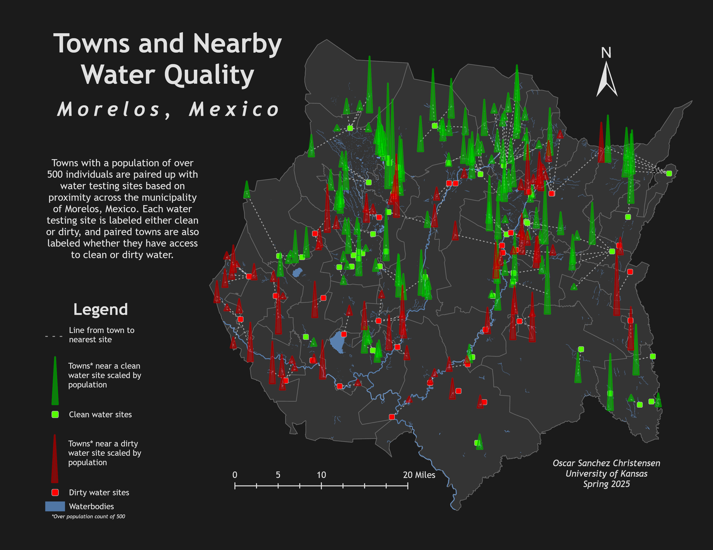

# Clean Water Access in Morelos, Mexico

A GIS analysis of which towns in the Mexican state of Morelos are near clean or dirty water-testing sites. Built in ArcGIS Pro for GEOG 358 at the University of Kansas (Spring 2025) and funded by an Undergraduate Research Award.

## Research question
Which towns in Morelos have access to clean water, and does population correlate with water cleanliness?

## Data sources
| Source | What I used |
| --- | --- |
| CONAGUA / RENAMECA | Water-quality testing sites: 7,251 sites nationwide, 188 in Morelos, 446 attributes per sample. Only the most recent sample for each site was kept. |
| INEGI | 2020 census population data for 1,678 localities in Morelos |
| DATA México | Waterbody data |

## Method
1. **Prepare the data in Excel and ArcGIS Pro.** Filtered the national dataset to the 188 Morelos sites and kept the most recent sample for each.
2. **Classify each site as clean or dirty** using the thresholds below.
3. **Create points and join data.** Converted XY tables to point layers and joined census and testing data.
4. **Pair towns with testing sites.** For towns with more than 500 residents, used a spatial join to find the nearest testing site, then drew connecting lines (XY to line).
5. **Build the spike map.** Scaled spike height by population using symbol effects and Arcade expressions, and colored each spike by whether its nearest site is clean or dirty.

### Clean-water thresholds
Thresholds and units are as defined in my project slides.

| Attribute | Clean |
| --- | --- |
| Alkalinity | 20-200 mg/L |
| Fecal coliforms | Below 200 CFU/100 mL |
| Escherichia coli | Below 50 |
| Oxygen demand | Below 0.5 mg/L |
| Total nitrogen | Below 10 mg/L |
| Total phosphorus | Below 0.1 mg/L |
| Surface salinity | Under 800 mg/L |
| Dissolved oxygen | Above 6 mg/L |
| Total suspended solids | Under 10 mg/L |
| Turbidity | Under 5 NTU |
| Water temperature | 20-25 degrees C |

## Result
Visually, denser clusters of towns appear to sit near clean-water sites. I did not run a statistical test, so this is an observation and not a finding.

## Limitations
- The town-to-site pairing assumes the nearest testing site reflects the water a town uses.
- Only the most recent sample per site is used, so seasonal and year-to-year changes are not captured.
- Towns under 500 residents are excluded.
- No formal correlation analysis was done.

## Tools
ArcGIS Pro (spatial join, XY to line, Arcade expressions), Excel

## Files
- `images/morelos_map.png`: final map
- `docs/`: project proposal (PDF) and final presentation slides

## Author
Oscar Sanchez Christensen, University of Kansas
